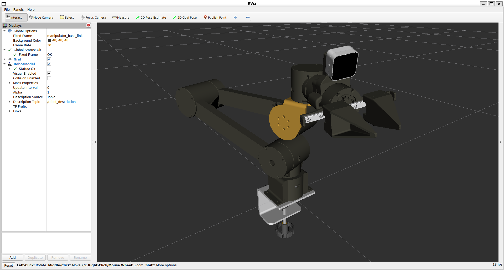
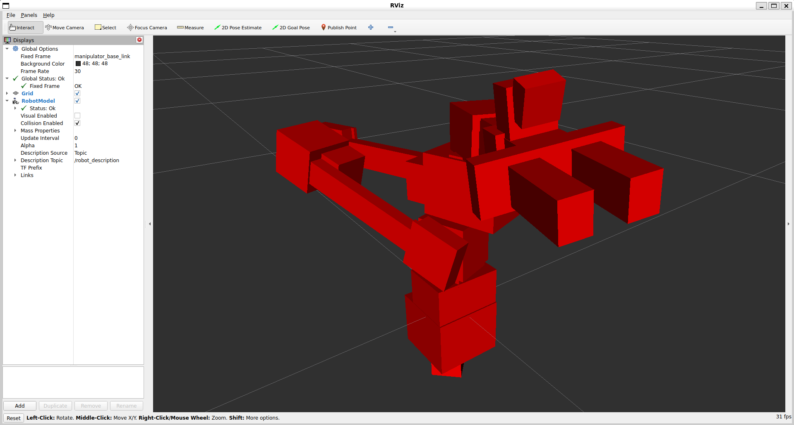

# Ulixarm Description

This repository contains the URDF model of **Ulixarm** with visual and collision meshes. It also features dynamic parameters, computed from the CAD model.

```text
ulixarm_description/
├── assets/
├── launch/
├── src/
│   └── ulixarm_description/
│       ├── meshes/
│       │   ├── collision/
│       │   └── visual/
│       └── urdf/
│           ├── robot.urdf
│           ├── robot.urdf.xacro
│           ├── gripper.urdf.xacro
│           └── manipulator.urdf.xacro
├── CMakeLists.txt
├── package.xml
├── LICENSE
└── README.md
```

The main robot description is defined in `robot.urdf`. The remaining URDF files are Xacro files used to keep the robot description modular and readable.

## Visual Meshes



## Collision Meshes



## License

This project is licensed under the [Apache License 2.0](LICENSE).
