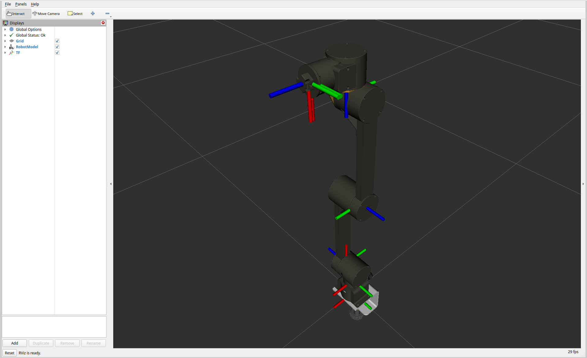
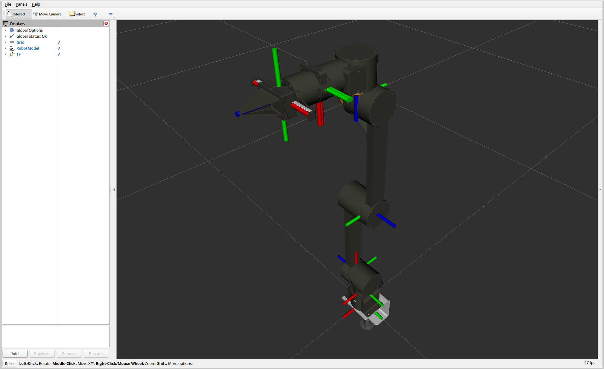
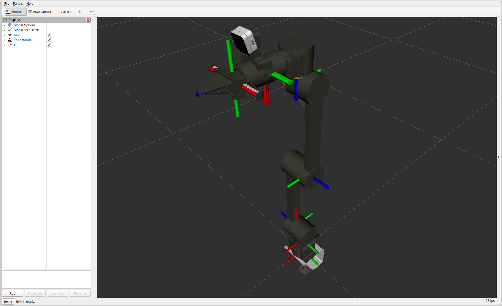
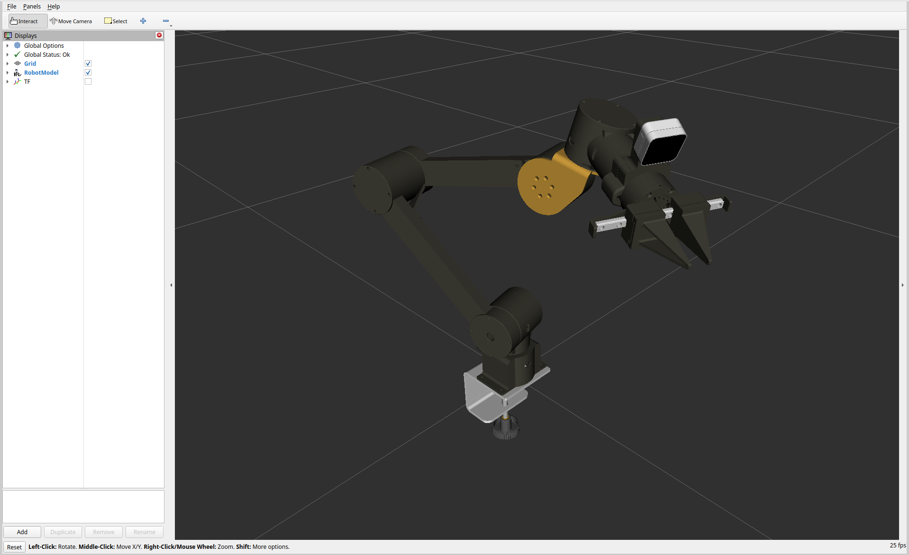
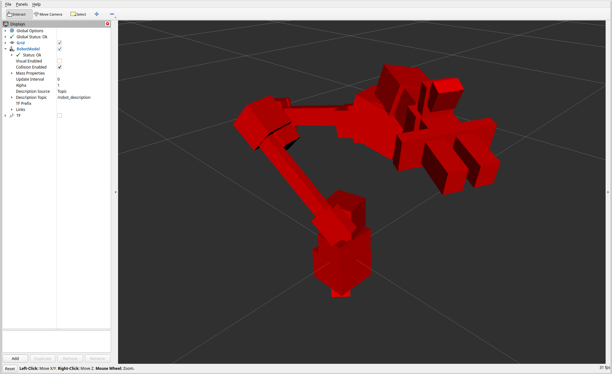

# Ulixarm Description

This repository contains the URDF model of **Ulixarm** with visual and collision meshes. It also features dynamic parameters, computed from the CAD model.

```text
ulixarm_description/
├── assets/
├── launch/
├── src/
│   └── ulixarm_description/
│       ├── meshes/
│       │   ├── collision/
│       │   └── visual/
│       └── urdf/
│           ├── arm.urdf
│           ├── arm_gripper.urdf
│           ├── arm_gripper_camera.urdf
│           ├── robot.urdf.xacro
│           ├── gripper.urdf.xacro
│           └── manipulator.urdf.xacro
├── CMakeLists.txt
├── package.xml
├── LICENSE
└── README.md
```

Three ready-to-use robot descriptions are provided:

- `arm.urdf`: arm only
- `arm_gripper.urdf`: arm + gripper
- `arm_gripper_camera.urdf`: arm + gripper + camera

They are generated from `robot.urdf.xacro`. Install xacro (ROS 2 Jazzy):

```bash
sudo apt install ros-jazzy-xacro
```

Then, from the repository root:

```bash
source /opt/ros/jazzy/setup.bash
colcon build --packages-select ulixarm_description
source install/setup.bash
U=src/ulixarm_description/urdf
xacro $U/robot.urdf.xacro gripper:=false -o $U/arm.urdf
xacro $U/robot.urdf.xacro camera:=false  -o $U/arm_gripper.urdf
xacro $U/robot.urdf.xacro                -o $U/arm_gripper_camera.urdf
```

The build step is needed because the xacro files use `$(find ulixarm_description)`.

The remaining URDF files are Xacro files used to keep the robot description modular and readable.

## Configurations

### Arm



### Arm + Gripper



### Arm + Gripper + Camera



## Visual Meshes



## Collision Meshes



## License

This project is licensed under the [Apache License 2.0](LICENSE).
